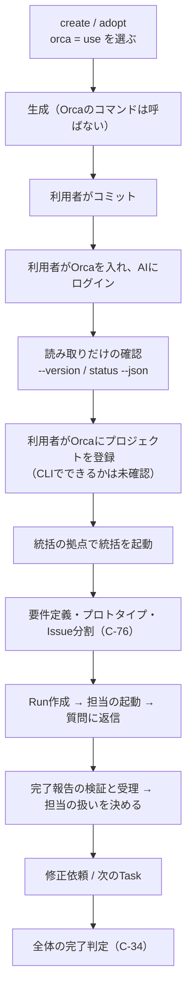

# 設計書：Orca連携と統括AIによる進行（Issue #59）

**この設計書は実装前のものである。** 書かれている質問の項目名・ファイルの置き場所・処理は案で、実装する子Issue（#60・#61・#62・#63）で確定・修正する。コード（`src/`）・データ（`data/`）・テンプレート（`templates/`）は、#59では変えない。要件は[F-30](../requirements/functional.md#f-30)、根拠は[Orca CLIの調査メモ（#57）](../plans/57-orca-cli-research.md)と[利用上限の調査メモ（#58）](../plans/58-usage-limit-research.md)。

## 目的

- 利用者が選んだときだけ、生成するプロジェクトで、統括のAIがOrcaのオーケストレーションを使って担当のAIを起動し、要件の合意から完了の判定まで進められるようにする
- 利用量の上限に達したときに、待機と再開を、重複や取りこぼしなく行えるようにする
- 連携を選ばない場合の生成物と、Orcaが入っていない環境での動作は変えない

範囲外：上限に達する前の主担当の交代（#8）、Orcaの自動実行（Automation。作らない）、AIでない制御処理（再開用のプログラム。#8の使用率の監視と合わせて検討する）。

## ファイルと役割（予定）

| 場所（案） | 役割 | 種類（[F-27](../requirements/functional.md#f-27)） | 担当のIssue |
| --- | --- | --- | --- |
| `data/consistency-rules.yaml` | 整合性チェック2件（`orca`が`none`で`orchestrator_ai`がある、`orchestrator_ai`が`ais`にない） | ハーネスのデータ | #60 |
| `data/role-models.yaml`・`src/generate/roles.ts` | 統括にCodex側の割り当て（GPT-6 Sol（medium））を足す | ハーネスのデータ・コード | #60 |
| `src/questions/` | 質問`orca`・`orchestrator_ai`（モデルの質問は作らない） | ハーネスのコード | #60 |
| `docs/orca/`の統括の指示 | 統括が従う手順（[F-30](../requirements/functional.md#f-30)の(c)(d)(e)(h)） | ハーネスが管理するもの | #62 |
| `docs/orca/`の進行の記録のひな形 | 進捗・完了条件・未解決・次の作業・担当の識別情報（形式は#62） | プロジェクトのもの | #62 |
| `.harness/config.yaml` | `answers.orca`・`answers.orchestrator_ai`・`roles.orchestrator` | ハーネスの記録 | #60 |
| `harness status`の表示 | 連携の選択を表示する | ハーネスのコード | #61 |
| 環境の確認（読み取りだけ） | `orca --version`・`orca status --json`・`claude --version`・`codex --version` | ハーネスのコード | #63 |

- Orca連携のためにSkillを足すときは、[F-21](../requirements/functional.md#f-21)のSkillの表と`scripts/check-spec-coverage.ts`の`SKILL_FOLDERS`も更新する（#62）
- 既存の設計書（[質問](questions.md)・[生成](generation.md)・[更新](update.md)・[導入](adopt.md)）は、実装のPR（#60・#61）で直す。#59では触れない

## 処理の流れ

生成と起動を分ける。ハーネスのコマンドは生成だけを行い、Orcaを起動しない。

### 生成（ハーネスのコマンド）

1. `create`・`adopt`が、`orca`と`orchestrator_ai`を聞く（`--answers`でも書ける）
2. 整合性チェック（[F-08](../requirements/functional.md#f-08)）の後、`orca`が`use`のときだけ、統括の指示と進行の記録のひな形を生成する
3. `.harness/config.yaml`に、選択と`roles.orchestrator`を記録する。拠点のパス・アカウント・認証の状態・Run／Task／Dispatchの識別子は記録しない
4. `update`は、記録された回答で同じように作り直す。`orca`を`none`に戻したときは、生成済みのOrca向けのファイルを消さず、知らせる

### 統括の動き（導入先で、利用者が指示してから）

1. Orcaの機能の一覧（`runtime.capabilities`）で、使える機能を判定する。版の数字では判定せず、無い項目は「ない」として扱う
2. 拠点は、導入手順で利用者が選ぶ。担当の配置は、既定で`--worktree current`
3. 担当の起動で、`orchestration.worker-launch-preferences.v1`があるときだけ、`roles`のモデルと推論の強さを渡す。拒否されたら省き、`launch.effective`をIssueに記録する
4. 担当の完了報告は、検証してから受理する。受理した後の担当は、再利用・保持・解放のどれかに必ず決める
5. 質問、返信、修正依頼、次のTaskは、[F-30](../requirements/functional.md#f-30)の(d)に従う。利用者に確認する節目では、統括も担当も止まる

### 利用量の上限に達したとき

1. 上限の種類を見分ける。待機の対象は、時間で回復する利用量の上限だけ。コンテキスト・短期の制限・認証・支出は別に扱う
2. 進行の記録を、作業の区切りごとに、上限に達する前に保存しておく
3. 対話の端末で動くClaude Codeの担当は、自動継続に任せる（3回まで。権限の確認で止まる）。それ以外は、手動の再開の手順に案内する
4. 担当の状態は、`live`・`unverifiable`・`exited`で判定する。止める・やり直すのは、`exited`か受理された完了報告のときだけ
5. 再開の前に、二重の依頼がないかを確かめる。統括自身が止まったときは、再開した統括が、進行の記録と`worker-list`を読んで続ける
6. 再開できない場面は、[F-30](../requirements/functional.md#f-30)の(e)の表のとおり、手動の手順を案内する

## `.harness/config.yaml`の項目（案）

| 項目 | 値 | 備考 |
| --- | --- | --- |
| `answers.orca` | `none`／`use` | 省略時は`none` |
| `answers.orchestrator_ai` | `claude`／`codex` | `orca`が`use`のときだけ |
| `roles.orchestrator` | AIとモデル（推論の強さ） | [C-66](../requirements/common/workflow.md#c-66)の初期値。利用者が変えられる |

## 受け入れ条件の対応

| AC | 内容 | 満たす場所 |
| --- | --- | --- |
| AC-1 | 連携あり／なしの質問・生成物・記録の形式・導入手順。Automationなし | [F-30](../requirements/functional.md#f-30)の(a)、[F-21](../requirements/functional.md#f-21)、[F-27](../requirements/functional.md#f-27)、[F-29](../requirements/functional.md#f-29)、対話の質問順の2-1・2-2、生成するファイルの条件の表。本書の「ファイルと役割」「`.harness/config.yaml`の項目」 |
| AC-2 | 統括AI・モデルの選択と、設定の生成からOrca起動までの手順 | [F-30](../requirements/functional.md#f-30)の(b)(c)と(a)の導入手順。本書の「処理の流れ」 |
| AC-3 | Orcaがなくても使える | [F-30](../requirements/functional.md#f-30)の(f)。本書の「目的」「処理の流れ」 |
| AC-4 | 要件合意→担当の起動→レビュー・修正→完了判定と、利用者確認の境界 | [F-30](../requirements/functional.md#f-30)の(d)(h)。[C-76](../requirements/common/workflow.md#c-76)の参照 |
| AC-5 | 統括・担当の利用上限時の待機・重複起動の防止・再開・非対応時の案内 | [F-30](../requirements/functional.md#f-30)の(e)。[C-66](../requirements/common/workflow.md#c-66)の「Claude Codeが使えないとき」の注記。本書の「利用量の上限に達したとき」 |
| AC-6 | 統括のCodex側の食い違いの解消と、決定の記録 | [F-30](../requirements/functional.md#f-30)の(b)(g)、[C-66](../requirements/common/workflow.md#c-66)の注記。データとコードは#60で足した（`orca: use` かつ `orchestrator_ai: codex` のときだけ `roles` に入れる。エージェントの定義への反映は#62） |
| AC-7 | F-21の更新箇所の洗い出し | 下の「F-21の更新が必要な箇所」 |

## 子Issueとの対応

| Issue | 範囲 |
| --- | --- |
| #60 | 質問`orca`・`orchestrator_ai`、`data/role-models.yaml`の統括にcodexを足す、`src/generate/roles.ts`の該当部分とコメント、整合性チェック2件、`generation.md`。モデルの質問は作らない |
| #61 | `orca`を`none`に戻したときの知らせ、`status`の項目、`update`・`adopt`の対応 |
| #62 | 統括の指示と進行の記録のひな形、進行の記録の形式、Skillを足す場合の表と`SKILL_FOLDERS`、C-66・C-76の参照の写し、信頼境界（仮）、再開できない場面の表、チャットの担当は自動継続を前提にしない |
| #63 | `capabilities`での判定、読み取りだけの環境確認、「Primary」と外部ウィンドウの実機の確認、Orcaが未導入のときの扱い |
| #65 | ゼロトラスト。信頼境界（仮）の見直し |
| #8 | 上限に達する前の主担当の交代、使用率の監視、複数の枠の定義、AIでない制御処理の検討 |

## F-21の更新が必要な箇所

| 箇所 | 更新 | 時期 |
| --- | --- | --- |
| `.harness/config.yaml`の行の「Issue #7」 | 旧リポジトリの番号。[F-27](../requirements/functional.md#f-27)に直し、Orca連携の選択を記録項目に足した | 済み（#59） |
| 生成するファイルの条件の表 | Orca向けのファイルの行を足した | 済み（#59） |
| Skillの表 | Orca用のSkillを足す場合に更新する | #62 |
| `scripts/check-spec-coverage.ts`の`SKILL_FOLDERS` | 同上 | #62 |
| `templates/skills/implementation-process/SKILL.md`の参照 | C-66・C-76の参照を写す | #62 |

## 調査メモの前提の反映

### #57の前提（13件）

| # | 前提 | 反映した場所 |
| --- | --- | --- |
| 1 | 機能の有無は`capabilities`の識別子で判定する | F-30の(c)（起動時のモデル）。本書の「統括の動き」1。確認の実装は#63 |
| 2 | 環境確認は読み取りだけ。連携なしでは`orca`を呼ばない | F-30の(a)の導入手順3、(c)の「環境の確認」 |
| 3 | 生成は起動するコマンドを呼ばない | F-30の(c)の「生成と起動」。本書の「生成」 |
| 4 | モデルと推論の強さは、利用者が決めたときだけ渡す。固定で入れるかは#59で決める | F-30の(c)の「担当の起動時のモデル」（機能があるときだけ渡す。利用者の決定） |
| 5 | 統括の指示は、標準の流れとTaskの5項目に合わせる | F-30の(c)(d)。本書の「統括の動き」 |
| 6 | 停止・やり直しは、`exited`か受理された完了報告のときだけ | F-30の(e)の「進行の記録と、重複の防止」 |
| 7 | 別のworktreeには、コミット済みの内容とspecだけが渡ると仮定する | F-30の(c)の「別のworktreeへの要件の渡し方」。open-itemsに記載 |
| 8 | 端末系のコマンドでなく、orchestrationのコマンドを使う | 本書の「統括の動き」。詳細は#62 |
| 9 | 監督と引き継ぎを区別する | F-30の範囲外の記述、[用語集](../requirements/glossary.md) |
| 10 | 認証情報・アカウント・個人のパスを出さない | F-30の(a)の「記録しないもの」 |
| 11 | Automationの質問・設定は作らない | F-30の冒頭、(a)の質問 |
| 12 | 「Primary」の定義と指定方法は未確定 | F-30の(c)の「統括の拠点」。open-items |
| 13 | Windowsで外部のウィンドウを開かないことは、確かめるまで確認済みと書かない | F-30の(c)の「外部のウィンドウ」。open-items |

### #58の前提（12件）

| # | 前提 | 反映した場所 |
| --- | --- | --- |
| 1 | 待機の対象は利用量の上限だけ | F-30の(e)の「待機の対象と、別に扱うもの」 |
| 2 | Claude Codeの自動継続は対話の端末の担当にだけ期待する | F-30の(e)の「再開の主体」1 |
| 3 | 3回を超えた・権限の確認で止まったときは、成功扱いにしない | F-30の(e)の「再開の主体」2 |
| 4 | Codexに自動継続を仮定しない | F-30の(e)の「再開の主体」3 |
| 5 | 進行の記録は、上限に達する前に保存する | F-30の(e)の「進行の記録と、重複の防止」 |
| 6 | 担当の状態は`live`／`unverifiable`／`exited`に従う。`--retry-request` | F-30の(e)の「進行の記録と、重複の防止」 |
| 7 | 統括自身が上限に達する場合を扱う | F-30の(e)の「進行の記録と、重複の防止」 |
| 8 | 再開不能の場面と、手動の手順 | F-30の(e)の表 |
| 9 | 手動の再開は、記録を読み、所有と状態を確かめてから。二重に依頼しない | F-30の(e)の手動の再開の前提 |
| 10 | 上限の回避・追加料金・別のアカウント・クレジットの消費はしない | F-30の(e)の「しないこと」 |
| 11 | 設定を生成物で書き換えない | F-30の(e)の「しないこと」（`autoContinueAtUsageLimit`） |
| 12 | 使用率の取得は#8の入力。#7は上限に達した後 | F-30の冒頭の範囲外、(e)の最後。本書の「目的」 |

## 未確認の事項

[未決定事項](../requirements/open-items.md)に並べた。確認の日は2026-11-03、`orca` 1.4.245・Windows 11。確かめるまでは、安全側の前提で進める。
